<div align="center">

# Getting paid from abroad, for beginners

[中文](./README.md) · **English**

### Money from abroad, onto your own card, the legitimate way

For people who live in mainland China and get paid from abroad: a client overseas, income from what you publish, or a shop on a foreign marketplace.<br>Three short lessons explain the legs a payment takes home and what each one costs, what the USD 50,000 quota covers, and why an account only works in your own name.

**[Start with lesson 1 →](https://payout.xiaoxiaodong.ai/en/start/1-three-legs/)**　·　**[Already getting paid? The full guide →](https://payout.xiaoxiaodong.ai/en/guide/0-map/)**

<sub>Unofficial · free · open source · Chinese and English</sub>

</div>

<p align="center">
  
</p>

## Your first US dollars just came in. Now what?

You've landed your first client abroad. You delivered, sent a USD 100 invoice, and today the client wrote back to say they've paid. You open PayPal and the balance is a few dollars short of 100. Then you open your banking app, and nothing has reached your card yet.

Where did those few dollars go? And how does the rest turn into RMB on your card? Before you've worked it out, someone tells you that you can only change USD 50,000 a year, and your client asks whether you have a US PayPal account.

This site takes those questions one at a time. It only covers the legitimate route: your own identity, your real address, and accounts in your own name.

## A payment home takes three legs

Between your client's account and your bank card there are three legs. The client pays you. The money lands in a receiving account in your own name, where it's still US dollars sitting abroad. Then it becomes RMB on your card. That's the trip the coin takes in the picture above.

Each leg takes a cut, and what it takes is written on that provider's own fee pages. Take the new accounts on paypal.cn. A receiving fee comes off as the money comes in, a settlement fee when you settle it to RMB, and the conversion cost is built into the exchange rate, with no line of its own on your statement, so it's easy to miss.

That's why this site never gives you one "you keep 95%" figure. Each cut is taken at a different moment, on a different amount. The receiving fee is charged on the whole payment and includes a fixed fee, so the smaller the payment, the bigger the share it takes. The settlement fee is charged on the part of the balance you settle. And the conversion cost hides inside the rate. So the site lists money leg by leg, with the page each number came from and the date it was checked. For one PayPal payment worked through from start to finish, see [What a USD 100 PayPal payment leaves you with](https://payout.xiaoxiaodong.ai/en/howto/paypal-100/).

## The USD 50,000 quota is a fast lane, not a wall

<p align="center">
  
</p>

The USD 50,000 a year is the part of your settlements you can do with just your ID, and its full name is the annual facilitation quota. SAFE's Xiamen branch puts it most plainly: the USD 50,000 equivalent is "an annual facilitation quota, not a limit on what an individual can settle or buy each year" ([SAFE Xiamen tips](https://www.safe.gov.cn/xiamen/file/file/20211022/f4794075e84e40dd9394be523a52731b.pdf)). For real income above it, bring your ID and documents showing the transaction amount, and the bank can still settle it. Some settlements never use the quota at all, such as personal FX under a payment institution's FX business. But whether the RMB a particular provider pays to your card counts is unclear, so ask that provider or your bank first. [Lesson 2](https://payout.xiaoxiaodong.ai/en/start/2-quota/) covers all three lanes, and why splitting amounts or borrowing someone else's quota is out.

## Thinking of a US PayPal account?

You've agreed a price with a US client, and their last line is "Just send me your PayPal." You search around, and plenty of posts say a US PayPal account is the easy way.

Start with PayPal's US user agreement, which says it was last updated on 2026-11-04. Right at the start, it says an individual must be a resident of the United States or one of its territories, and at least 18, to open a US PayPal account. It also lists giving false, inaccurate or misleading information about your identity, account or business as a restricted activity, and PayPal can respond by holding your balance for up to 180 days ([PayPal US user agreement](https://www.paypal.com/us/legalhub/paypal/useragreement-full)). If you live in mainland China, you don't meet the first condition. Opening one would mean giving untrue details about your address or identity, and that's exactly what the agreement forbids. So this site doesn't teach that route or describe how it's done. Hong Kong PayPal and Hong Kong Stripe work the same way, and both go by where you really live. The details are in [Thinking of a US PayPal account? Read this first](https://payout.xiaoxiaodong.ai/en/howto/us-paypal/).

Your US client can still pay you. Tell them up front that you're in mainland China, then give them a way to pay that works for them. If they want to pay by PayPal, open a personal seller account with 贝宝支付 (PayPal's company in Beijing) on [paypal.cn](https://www.paypal.cn/) and send them a PayPal invoice or payment link. If they want to send a bank transfer, use an account that can give you USD account details, such as Wise (whether you get them is whatever Wise shows you). Check one thing first. PayPal's pages don't say whether a personal seller account can take service income, like freelance or creator income, and Wise's pages don't say whether a personal account can receive business income. Ask PayPal China or Wise before you open one. [Lesson 3](https://payout.xiaoxiaodong.ai/en/start/3-own-name/) explains why an account only works in your own name.

## Beginners need just three lessons

Those three topics are the three beginner lessons, one each. Read them in order, about 25 minutes in all.

<p align="center">
  
</p>

1. **[A payment home takes three legs](https://payout.xiaoxiaodong.ai/en/start/1-three-legs/)**: who pays you, which account the money lands in first, and how it becomes RMB on your card, with a fee at each leg.
2. **[The USD 50,000 quota: what it is and isn't](https://payout.xiaoxiaodong.ai/en/start/2-quota/)**: what the USD 50,000 covers and what it doesn't, and what to bring when you go over it.
3. **[Accounts only work in your own real name](https://payout.xiaoxiaodong.ai/en/start/3-own-name/)**: providers go by who you are and where you really live, and what happens if you use someone else's address, ID or account.

Everything beyond the three lessons is there to look up when you need it.

## Already getting paid?

- **[The full guide](https://payout.xiaoxiaodong.ai/en/guide/0-map/)**: six steps, in order. Where your money comes from, picking a receiving account, opening it in your own name, keeping the paper trail from day one, bringing it home in RMB, and adding up each leg's fees.
- **[How-to](https://payout.xiaoxiaodong.ai/en/howto/)**: six specific jobs. What a USD 100 PayPal payment leaves you with, moving USD from Wise to your Chinese bank card, settling more than USD 50,000 in a year, what to do when PayPal limits or freezes your account, what to read before opening a US PayPal account, and tutorials you shouldn't follow.
- **[Wiki](https://payout.xiaoxiaodong.ai/en/wiki/)** and **[FAQ](https://payout.xiaoxiaodong.ai/en/faq/)**: words like receiving account, settlement, payment institution and watch list, and the questions people ask the first time they're paid from abroad.

## Where the facts come from

China's FX rules come from the original texts of the People's Bank of China and SAFE (the State Administration of Foreign Exchange): the personal FX measures and their implementing rules, the 2020 current account guide, and Q&As from SAFE's branches. Each provider's fees and sign-up conditions come from its own agreements, fee pages and help center. Every point links to its source on the page. Every fee and limit says the date it was checked, plus the page's own last-updated date when it has one. When an official page doesn't say, the site marks the point as unconfirmed and tells you to ask the provider or your bank. The list of sources is in [docs/sources/README.md](docs/sources/README.md) (in Chinese).

Experiences people share on X are quoted only as what someone tried, labelled as personal experience, with a link to the post. They're never the source for a rule, a fee or a step, and when a post disagrees with an official page, the official page wins.

The site only covers getting paid and settling in your own name, at your real address, into accounts you own. It won't teach these, and it won't repeat how posts online do them:

- Opening a foreign account with an address or identity that isn't yours, such as a US PayPal, Hong Kong PayPal or Hong Kong Stripe account, including with a forwarding address or a borrowed one
- Splitting amounts so each one stays under some number
- Borrowing someone else's quota, ID or account, or having money paid to you through someone else's account
- Writing a purpose or transaction type on a transfer that isn't true
- Turning crypto into RMB, whether through an exchange, C2C or an OTC dealer, and underground banks or offsetting-payment (对敲) schemes don't get a mention either
- Referral codes, invite links or affiliate links, the author's own included

## Unofficial, and not legal or tax advice

This is an unofficial guide, not affiliated with PayPal, Wise, Payoneer, WorldFirst or any bank, and it doesn't speak for them. Nothing here is legal or tax advice, and the site doesn't cover tax. For tax questions, ask your local tax authority or a professional. Fees and rules change. Each provider's own pages and your bank are the reference, and for China's FX rules, [SAFE](https://www.safe.gov.cn/) is.

## Run it locally

```bash
npm install
npm run dev        # http://localhost:4450
npm run build      # writes dist/
npm run check      # after a build: zh/en parity check and whole-site check
```

Stop the dev server when you're done, and check the port is free with `lsof -i :4450`. The three animated pictures in this README are generated by scripts, which read the lesson titles and times from `src/data/nav.js`:

```bash
python3 tools/build_hero.py          # assets/hero.svg, assets/en/hero.svg
python3 tools/build_readme_svgs.py   # quota.svg and lessons.svg in assets/readme/ and assets/en/readme/
```

Writing rules, sources and the check scripts are in [docs/MAINTAINING.md](docs/MAINTAINING.md) (in Chinese). The site shell comes from the [Saily for Beginners guide](https://github.com/nevertoday/xxd-saily), and the interface uses the Xiaoxiaodong UI Kit.

## License

Code and text are MIT licensed. See [LICENSE](LICENSE). `public/xxd/` is a build of the Xiaoxiaodong UI Kit and isn't covered by the MIT license; see `public/xxd/LICENSE`.
