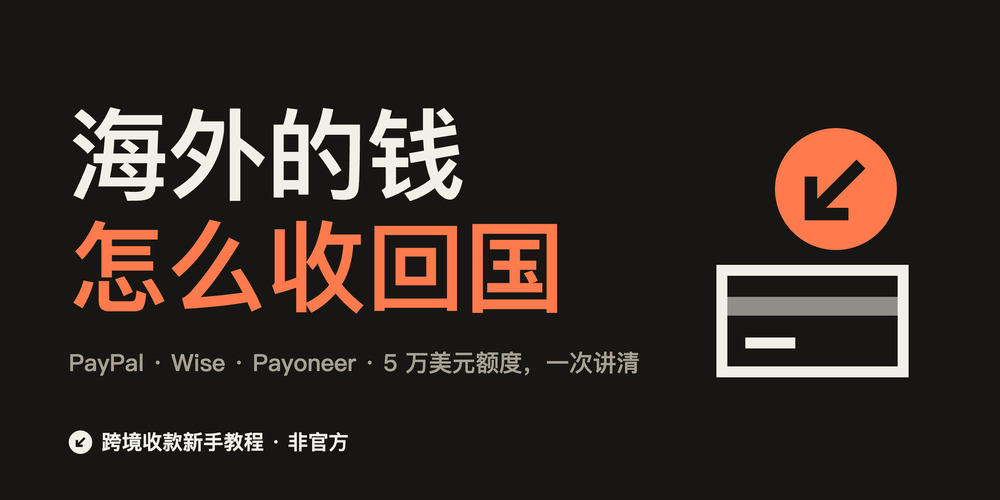

<div align="center">

# 跨境收款新手教程

**中文** · [English](./README.en.md)

### 海外的钱，干干净净回到自己卡上

</div>

<p align="center">
  
</p>

写给住在中国大陆、从海外收钱的人（接海外客户的活、做内容、开网店）：怎么选一个正规的收款账户，每一段的费用怎么算，5 万美元的额度管什么，钱怎么换成人民币到你自己的银行卡上。

**网站正在写，还没上线。** 上线后的地址是 payout.xiaoxiaodong.ai。

这是一个非官方的学习站，和 PayPal、Wise、Payoneer、万里汇（WorldFirst）或任何银行都没有关系，也不代表它们的说法。本站讲的不是法律或税务建议。费用和规则一直在变，以各家自己的页面和你的开户银行为准，外汇规定以国家外汇管理局为准。

本站只讲用你自己的身份、真实地址和自己名下的账户收钱。不教用别人的或不是你住的地址、身份开海外账户，不教拆分金额、借别人的额度、把汇款用途写成别的，不教用加密货币换成人民币，也不放推荐码。

## 本地运行

```bash
npm install
npm run dev        # http://localhost:4450
npm run build      # 输出到 dist/
npm run check      # 中英文对照检查 + 整站检查
```

写作规矩、资料来源和检查脚本见 [docs/MAINTAINING.md](docs/MAINTAINING.md)，资料和出处在 [docs/sources/README.md](docs/sources/README.md)。网站骨架沿用小小东的 Saily 新手教程站（xxd-saily），界面用小小东 UI Kit。代码和文字用 MIT 许可，见 [LICENSE](LICENSE)；`public/xxd/` 是小小东 UI Kit 的构建产物，不在 MIT 范围内，见 `public/xxd/LICENSE`。
