<div align="center">

# 跨境收款新手教程

**中文** · [English](./README.en.md)

### 海外的钱，怎么正规地回到你卡上

写给住在中国大陆、从海外收钱的人：接了海外客户的活，做的内容有了收入，或者在海外平台开了网店。<br>三节课讲清一笔钱回国要走哪几段、每段扣什么钱，5 万美元额度管什么，为什么账户只能用你自己的身份。

**[从第 1 课开始 →](https://payout.xiaoxiaodong.ai/start/1-three-legs/)**　·　**[已经在收钱了，看完整教程 →](https://payout.xiaoxiaodong.ai/guide/0-map/)**

<sub>非官方 · 免费 · 开源 · 中文和英文</sub>

</div>

<p align="center">
  
</p>

## 第一笔美元到了，然后呢

你在海外有了第一位客户。东西交出去，开了一张 100 美元的账单，今天客户回信说，钱付了。你打开 PayPal，余额比 100 美元少了几块；再打开银行 App，卡上一分钱都还没到。

少掉的那几块去了哪？剩下的钱，又要怎样才能变成卡上的人民币？还没想明白，就有人跟你说「一年只能换 5 万美元」；客户那边也来问，你有没有美国的 PayPal。

这几件事，这个网站一件一件讲清楚。它只讲正规的路：用你自己的身份、真实的地址和自己名下的账户。

## 一笔钱回国，要走三段路

从客户的账户到你的银行卡，中间隔着三段：客户付给你；钱落进你名下的收款账户，这时候它还是美元，放在海外；再换成人民币，打到你的卡上。头图里那枚硬币，走的就是这三段。

每一段都会扣一笔钱，扣多少，写在那一家自己的费用页上。拿 paypal.cn 上的新账户举例：钱进账户时扣收款费，结算成人民币时扣结算费，换汇的钱含在汇率里，账单上没有单独一行，常常看不见。

所以本站不给「到手 95%」这样一个数。这几笔钱扣的时间不一样，按的基数也不一样：收款费按客户付的整笔算，还带一笔固定费用，付款越小，扣掉的比例越高；结算费按你结算的那部分余额算；换汇的钱又藏在汇率里。本站讲到钱，都按段列，每个数字写明出自哪一页、是哪天查的。一笔 PayPal 付款从头到尾算一遍，看[100 美元的 PayPal 付款，最后到手多少](https://payout.xiaoxiaodong.ai/howto/paypal-100/)。

## 5 万美元是快速通道，不是一堵墙

<p align="center">
  
</p>

每人每年等值 5 万美元，是只凭身份证就能结汇的那一部分，全名叫年度便利化额度。外汇局厦门分局的问答说得最直白：「等值 5 万美元是年度便利化额度，不是个人每年结汇、购汇的限额。」（[厦门分局个人外汇服务小贴士](https://www.safe.gov.cn/xiamen/file/file/20211022/f4794075e84e40dd9394be523a52731b.pdf)）真实的收入超过了，带上身份证和写着交易金额的材料，到银行照样能结汇；有些结汇本来就不占额度，比如支付机构外汇业务下的个人结售汇。可某一家收款平台打到你卡上的人民币算不算这一种，说不准，办之前先问它或你的开户银行。这三条路，还有为什么不能拆分金额、不能借别人的额度，[第 2 课](https://payout.xiaoxiaodong.ai/start/2-quota/)都讲了。

## 想开美区 PayPal？

美国的客户谈好了价钱，最后一句是「Just send me your PayPal」。你上网一搜，不少帖子说开个美区 PayPal 最省事。

先看 PayPal 美国的用户协议，页面写的最近更新日期是 2026-11-04。它开头就写了，个人必须是美国或美国属地的居民、年满 18 岁，才能开美国的 PayPal 账户；它还把提供关于身份、账户或业务的虚假、不准确或误导性信息列为受限活动，PayPal 可以因此扣住你的余额，最长 180 天（[PayPal 美国用户协议](https://www.paypal.com/us/legalhub/paypal/useragreement-full)）。你住在中国大陆，本来就不符合开户条件；要开成，就得在地址或身份上提供不真实的信息，而这正是协议禁止的。所以本站不教这条路，也不讲它的做法。港区 PayPal、香港的 Stripe 也是同一个道理，都按你真正住在哪里开户。详细的看[想开美区 PayPal？先看这一页](https://payout.xiaoxiaodong.ai/howto/us-paypal/)。

美国客户照样能付给你。跟客户直接说你在中国大陆，再给他一个他用得上的付款方式：他想用 PayPal 付，你就在 [paypal.cn](https://www.paypal.cn/) 开一个贝宝支付的个人卖家账户，给他发 PayPal 账单或付款链接；他想银行转账，就用 Wise 这类能给出美元收款信息的账户（能不能拿到，以你在 Wise 里实际看到的为准）。要留意的是，个人卖家账户能不能收接活、做内容这类服务收入，Wise 的个人账户能不能收生意上的钱，官方页面都没有写明，开户之前先问 PayPal 中国或 Wise。账户为什么只能用你自己的身份开，[第 3 课](https://payout.xiaoxiaodong.ai/start/3-own-name/)讲。

## 新手只要三课

上面这三件事，就是新手入门的三课，一课讲一件。按顺序看，一共二十多分钟。

<p align="center">
  
</p>

1. **[一笔钱回国，要走三段路](https://payout.xiaoxiaodong.ai/start/1-three-legs/)**：谁付钱给你、钱先落在哪个账户、再怎么变成人民币到你卡上，每一段各有各的费用。
2. **[5 万美元额度：是什么，不是什么](https://payout.xiaoxiaodong.ai/start/2-quota/)**：这 5 万美元管的是什么、不管什么，超过了要准备哪些材料。
3. **[账户只能用你自己的真实身份](https://payout.xiaoxiaodong.ai/start/3-own-name/)**：海外的收款账户认的是你是谁、真正住在哪；用别人的地址、身份或账户会出什么事。

三课之外的内容，遇到了再查。

## 已经在收钱了？

- **[完整教程](https://payout.xiaoxiaodong.ai/guide/0-map/)**：6 步，按顺序走一遍。先看清钱从哪来，选一个收款账户，用自己的身份开户，从第一天起留好凭证，把钱换成人民币到卡上，最后算清每一段的费用。
- **[How-to](https://payout.xiaoxiaodong.ai/howto/)**：6 篇具体的事。100 美元的 PayPal 付款最后到手多少，Wise 里的美元怎么回到国内银行卡，一年超过 5 万美元怎么结汇，PayPal 账户被限制或冻结怎么办，想开美区 PayPal 先看什么，哪些教程不该照做。
- **[Wiki](https://payout.xiaoxiaodong.ai/wiki/)** 和 **[常见问题](https://payout.xiaoxiaodong.ai/faq/)**：收款账户、结汇、支付机构、关注名单这些词，和第一次收海外的钱最常问的事。

## 这些说法从哪来

外汇的规定，出自人民银行和国家外汇管理局的原文：《个人外汇管理办法》和实施细则、《经常项目外汇业务指引（2020年版）》，还有外汇局分局的问答。各家的费用和开户条件，出自它们自己的协议、费用页和帮助中心。每一条在页面里附原文链接；费用和限额都写明「截至」哪一天，页面自己写了更新日期的，两个日期都写。官方页面没写明的事，照「还没确认」写，告诉你去问服务商或开户银行。资料清单和出处在 [docs/sources/README.md](docs/sources/README.md)。

网友在 X 上分享的经验，只当作「有人这样做过」来引用，写明是网友的经验、附原帖链接，从来不当规定、费用或步骤的出处；帖子和官方说法不一样时，以官方为准。

本站只讲用你自己的身份、真实地址和自己名下的账户收钱、结汇。下面这些不教，网友帖子里的这类做法也不复述：

- 用不是你的地址或身份开海外账户，比如美区 PayPal、港区 PayPal、香港 Stripe，转运地址、借来的地址都算
- 拆分金额，让每一笔停在某个数下面
- 借用别人的额度、身份证或账户，或者用别人的账户收你的钱
- 把汇款用途、交易性质写成不是真的
- 用加密货币换成人民币，交易所、C2C、OTC 商家都算；地下钱庄、「对敲」的办法也不提
- 推荐码、邀请链接、返利链接，作者自己的也不放

## 非官方，也不是法律或税务建议

这是一个非官方的学习站，和 PayPal、Wise、Payoneer、万里汇（WorldFirst）或任何银行都没有关系，也不代表它们的说法。本站讲的不是法律或税务建议，也不讲税怎么交；碰到税的问题，问当地税务机关或专业人士。费用和规则一直在变，以各家自己的页面和你的开户银行为准，外汇规定以[国家外汇管理局](https://www.safe.gov.cn/)为准。

## 本地运行

```bash
npm install
npm run dev        # http://localhost:4450
npm run build      # 输出到 dist/
npm run check      # 构建以后：中英文对照检查 + 整站检查
```

开发服务器用完记得关掉，用 `lsof -i :4450` 确认端口空了。README 里的三张动图由脚本生成，课名和时间从 `src/data/nav.js` 读：

```bash
python3 tools/build_hero.py          # assets/hero.svg、assets/en/hero.svg
python3 tools/build_readme_svgs.py   # assets/readme/、assets/en/readme/ 里的 quota.svg、lessons.svg
```

写作规矩、资料来源和检查脚本见 [docs/MAINTAINING.md](docs/MAINTAINING.md)。网站骨架沿用 [Saily 新手教程](https://github.com/nevertoday/xxd-saily)，界面用小小东 UI Kit。

## 许可

代码和文字用 MIT 许可，见 [LICENSE](LICENSE)。`public/xxd/` 是小小东 UI Kit 的构建产物，不在 MIT 范围内，见 `public/xxd/LICENSE`。
